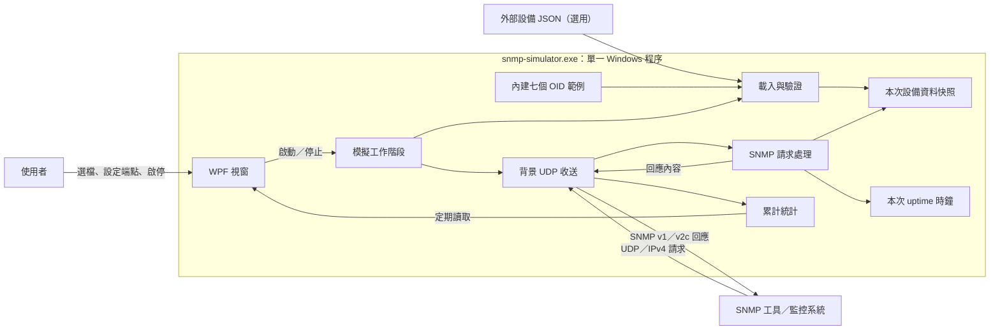
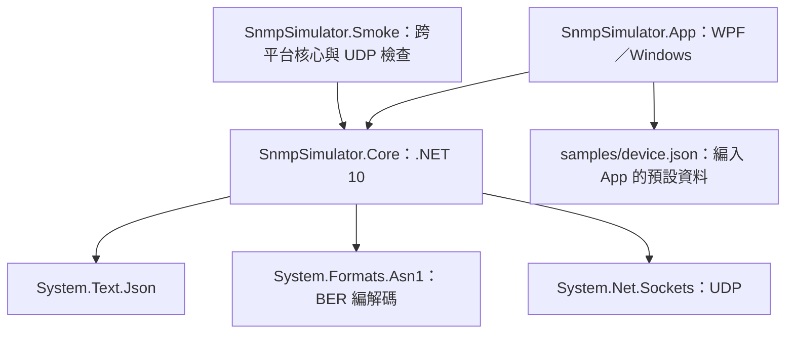
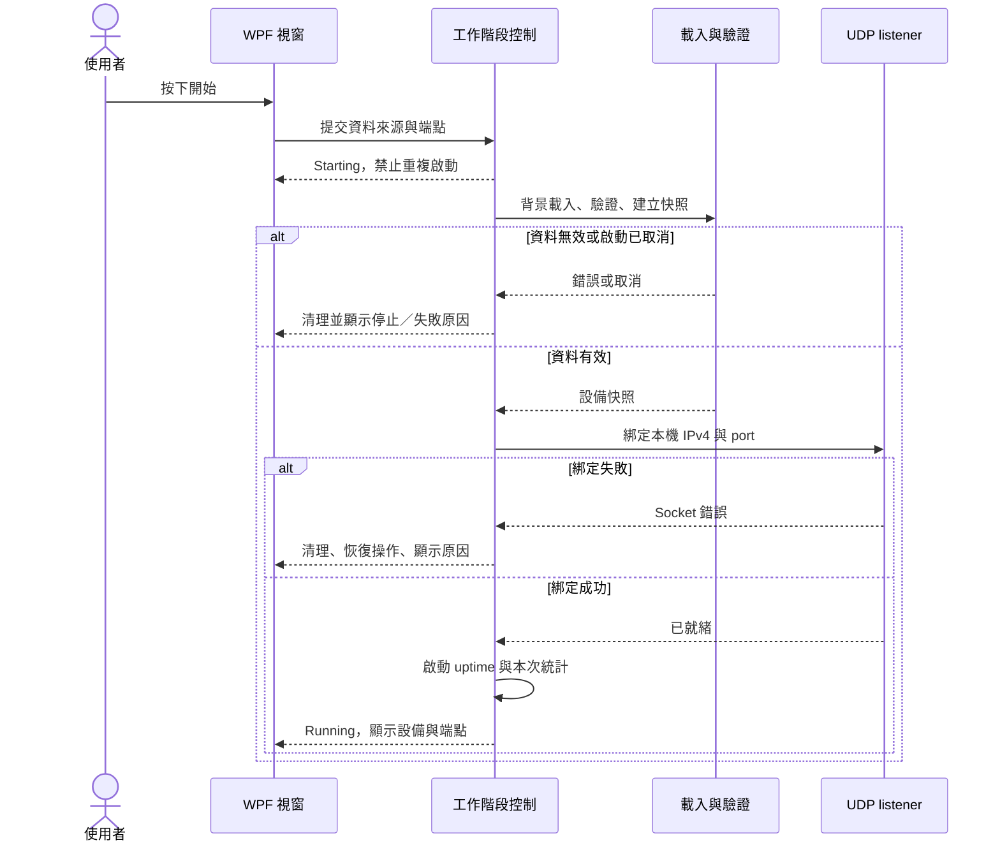
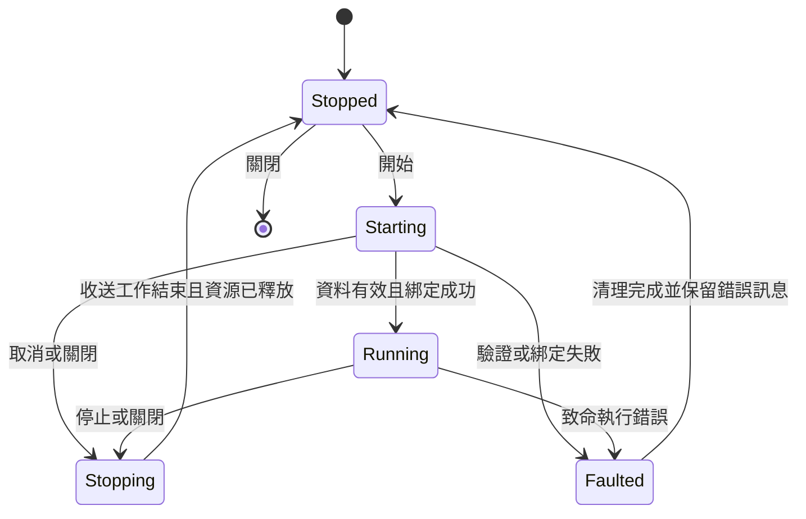
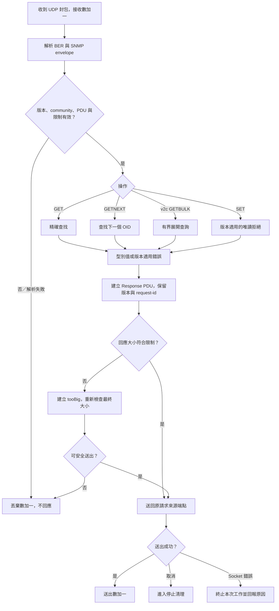

# SNMP Simulator 架構設計

文件狀態：已確認（v0.1.0 架構基準；不代表實作已完成或驗收通過）

目標版本：v0.1.0（初始功能原型）

需求依據：[requirements.md](requirements.md)（已確認）

整理日期：2026-11-03

## 1. 文件範圍與閱讀方式

本文件將已確認需求轉換為可實作、可驗證的架構。範圍為 .NET 10、Windows 10 22H2／Windows 11 x64、WPF、單設備、SNMP v1／v2c、唯讀查詢及單檔發布。

使用者已確認本文件作為 v0.1.0 架構基準。下文的「建議設計」與「建議補強」為後續任務規劃依據，不代表已完成程式調整；需要補驗或核對的細節仍須完成，涉及需求變更時另行確認。第 11 節對照現有原型與差距；本次只更新文件確認狀態，不修改程式、不新增 CI、不建立任務文件或發行版本。

架構圖直接以 Mermaid 嵌入本文件，讓說明與圖一起版本管理。GitHub 支援渲染；未支援 Mermaid 的 Markdown 檢視器會顯示圖形原始碼。圖中的元件是責任邊界，不表示每個方塊都要建立獨立專案、程序或介面。

## 2. 系統邊界與整體架構

採用一個 Windows 桌面程序、一個模擬工作階段、一個 IPv4 UDP listener。程式不需要資料庫、Web 服務、容器或外部 MIB 檔案。

界線與原則：

- 外部 JSON 只在啟動時讀取；收到請求後只使用本次記憶體資料。
- WPF 負責操作與顯示，不直接處理每筆封包；核心不依賴 WPF。
- 一次只執行一個工作階段，停止後釋放 socket，再允許下一次啟動。
- 網路、防火牆、壓測端與 Windows 暫存路徑屬執行環境，不由程式自動修改。
- 第一版不加入多 worker、無界請求佇列或每筆請求的 Task.Run；高吞吐量設計留待量測後調整。

## 3. 專案與模組責任

### 3.1 專案相依

維持現有三個專案。第一版沿用 .NET 內建 JSON、ASN.1 與 socket API，不新增 SNMP 套件；這能減少相依，但 SNMP 語意與邊界驗證責任仍在本專案。若後續發現協定完整度問題，再比較第三方套件，不能以自行實作為由省略互通測試。

### 3.2 邏輯元件

| 元件 | 責任 | 現有對應與建議 |
| --- | --- | --- |
| 視窗 | 選檔、端點輸入、命令與狀態、每秒更新統計 | 現有 MainWindow；可保留簡單 code-behind，不強制引入 MVVM 框架 |
| 工作階段控制 | 統一管理開始、停止、執行中工作、取消與資源清理 | 目前分散於 MainWindow／SnmpAgent；建議集中成可測試的生命週期邏輯 |
| 設定載入與驗證 | 將 JSON 轉為有效設備定義，提供可理解的欄位錯誤 | 現有 DeviceProfile.Load／Parse；補強 null、型別與範圍錯誤描述 |
| 設備資料快照與索引 | 保存本次不可變資料、精確 GET 查找及下一個 OID 查找 | 現有 Dictionary 與排序陣列；建議載入時完成型別轉換與 OID 數字段落解析 |
| uptime 來源 | 以單調時鐘計算本次啟動後的 TimeTicks | 現有 Stopwatch；每個工作階段獨立 |
| SNMP 請求處理 | 版本、community、PDU 分派、查詢語意、錯誤與限制 | 現有 SnmpAgent.Process／Next／Missing；可逐步拆開責任，不必新增專案 |
| BER 編解碼 | 解析封包結構、限制讀取、輸出版本適用的回應 | 現有 AsnReader／AsnWriter；不得把能解析 BER 當作 SNMP 語意已正確 |
| UDP 傳輸 | 綁定位址、接收封包、傳回原請求端點、取消與釋放 | 現有 SnmpAgent.RunAsync；不參與 JSON 或 UI 邏輯 |
| 統計 | 執行緒安全的接收、送出、丟棄累計值 | 現有 Interlocked 計數；不代表端到端送達或核心全部丟包 |

## 4. 設備資料與 OID 索引

### 4.1 資料來源

沿用 schemaVersion=1 的 JSON：name、community、objects；欄位與型別以需求文件及 [範例](../samples/device.json) 為準，不另創第二套格式。

沿用目前預選方式：EXE 同目錄若有 device.json，預選該檔；否則使用內建範例。使用者亦可手動選檔。明確選定的外部檔案載入失敗時應顯示錯誤，不靜默退回內建資料。

### 4.2 啟動時建立資料快照

建議啟動時完成以下工作：

1. 驗證 JSON、schema、必要欄位、null、OID、重複、型別與值範圍。
2. 將 OID 解析為數字段落，資料轉成受支援的型別值；不把 JsonElement 查詢留到每個封包才處理。
3. 建立精確查找索引與排序 OID 陣列；排序按數字段落比較。
4. 建立只供本次使用的資料快照，不向 UI 暴露可修改集合。
5. 固定值可預先產生 BER value；uptime 在查詢時計算，不預先固定。

精確 GET 預期使用雜湊查找；GETNEXT 使用排序陣列的二分搜尋，尋找嚴格大於請求 OID 的第一筆。此為資料結構選擇，不代表實際吞吐量承諾。

### 4.3 物件與實例

完整實例 OID 是回應資料的鍵。純量以 .0 結尾；第一版的 noSuchObject／noSuchInstance 判斷以設定中可辨認的純量物件為基礎。完整 MIB、任意 table 的物件定義與缺失實例判定不在本版範圍。

現有 Missing 使用字串推斷純量物件；建議改用啟動時建立的數字 OID／純量物件資訊並補測，避免將非相同前綴誤認為同一物件。這不增加 MIB 解析功能。

uptime 使用單調時鐘，不因使用者調整系統日期而跳動。計時從成功綁定位址後開始，值為經過毫秒數除以 10，再按 UInt32 取模。重啟會重新計時。

## 5. 啟動、停止與執行緒

### 5.1 啟動時序

以下為建議行為：資料解析在背景完成，UI 只接收結果與狀態；目前原型仍在 UI thread 讀取／驗證檔案，此差距需後續處理。

### 5.2 狀態圖

這是邏輯狀態，不要求新增六種視窗或複雜框架。正常停止不顯示為執行失敗；取消後需等背景工作結束，才允許再次啟動。狀態回報須綁定本次工作階段，避免舊工作完成回呼覆蓋新工作狀態。

### 5.3 執行緒與清理

- UI thread 只做視窗操作及定期讀取統計；背景工作不得直接變更 WPF 控制項，必須透過 Dispatcher。
- 一個背景非同步迴圈依序接收、處理、送出。它可處理來自不同用戶端的封包，但不代表同時在多核心平行處理。
- 工作階段持有自己的 CancellationTokenSource、Task、socket、時鐘與資料快照。
- 停止時取消接收／送出、等待工作結束，再釋放資源；啟動失敗也走相同清理路徑。
- 關閉視窗時取消工作，避免等待 Dispatcher 回呼造成死鎖。必要時延後關閉直到清理完成；不可在 UI thread 同步 Wait 背景 Task。
- 不假設 UDP 會重送或保證順序；重試與 timeout 由用戶端決定，第一版不快取或去重請求。

## 6. SNMP 封包處理

### 6.1 請求流程圖

回應使用已綁定的 socket 送至請求來源 IP／port。不把 wildcard 綁定解讀成多設備，也不在第一版做每個目的 IP 的設備分派。

### 6.2 操作與錯誤

| 情境 | 建議處理 |
| --- | --- |
| GET 命中 | 依設定型別與值回應；同一請求可含多個 varbind |
| GETNEXT | 取得下一筆；v1 結束使用 noSuchName，v2c 使用 endOfMibView |
| v2c GETBULK | 處理 non-repeaters 與 repeaters；max-repetitions 有界，逐輪維持 varbind 順序；到尾端依規範回覆 |
| 不存在的 OID | v1 回應 noSuchName 與首個出錯索引；v2c 依物件／實例情境回覆例外值 |
| SET | 不修改資料，回應版本適用拒絕錯誤；現有原型使用 v1 readOnly、v2c notWritable，完整語意仍需測試核對 |
| 畸形／超限／不支援請求 | 丟棄並計數；單一壞封包不可終止 listener |
| 綁定失敗／致命 socket 錯誤 | 結束工作階段、釋放資源、顯示原因；第一版不偷偷無限重啟 |

BER 可解析不代表封包一定符合 SNMP，例如錯誤欄位值、非法 varbind 或不適用的 PDU 仍需驗證。只攔截已知的解析／輸入錯誤；未預期的程式錯誤不能一律吞掉並偽裝成正常丟棄。

## 7. 資源上限與統計

第一版先以需求文件第 6 節列出的原型數值作為設計起點，均非容量承諾：

| 項目 | 建議沿用的起點 | 注意事項 |
| --- | --- | --- |
| 設備 OID | 100,000 | 是保護上限；第一版驗收資料只有七筆，不代表已驗證十萬筆載入 |
| 請求 varbind | 256 | 超限丟棄；解析必須在超限時停止 |
| GETBULK repetitions | 100 | 負值按零處理；超過上限依記錄的截限策略處理，需驗證協定相容性 |
| 輸出 varbind | 256 | 限制展開工作與記憶體；超限策略需與 GETBULK 大小限制一併測試 |
| 一般回應大小 | 1400 bytes | 原型門檻，不保證任何網路路徑都不分片；tooBig 最終編碼也須再次檢查 |

建議將限制集中管理並補上邊界測試。設定檔位元組大小與載入取消方式目前未有明確上限，需在任務階段列為補強項目，避免只限制物件數卻先讀取無限制檔案。若要新增使用者可見限制，應記錄原因與錯誤訊息。

v1 tooBig 可能包含原請求 varbind，編碼後仍可能過大；不得無條件送出。建議採「若錯誤回應仍超過已選定的安全送出界線，丟棄並計數」的策略，正式實作前核對版本規範與必要的最小封包支援。

統計在每次開始時歸零，停止後保留最後數值供查看。接收數只計到達程式的封包，送出數只計 socket 送出成功，丟棄數計應用層決定不回應的封包；socket 致命錯誤另以狀態顯示。這些值不應當作網卡丟包率或端到端成功率。

v0.1.0 不在 UI 新增 p99 儀表；後續由用戶端量測 p99 往返延遲並另報失敗率，500 ms 保留為暫定方向。

## 8. 發行與版本

- App 使用 net10.0-windows，Core／Smoke 使用 net10.0；只發行 win-x64。
- 使用 self-contained、PublishSingleFile 與必要原生元件解壓設定；範例 JSON 作為 embedded resource。
- 發布交付物為 snmp-simulator.exe，不要求使用者另帶 DLL、runtime 或範例檔；自訂 JSON 可另外攜帶。
- 本專案採 MIT，相依限經審查的寬鬆授權，依需求 LIC-01～04。self-contained EXE 包含的 runtime／原生元件也需核對；授權與 NOTICE 等必要內容採符合條款的內建或隨交付方式提供，不能因單檔目標而省略。本次僅記錄政策，聲明整合與實際產物審查仍待執行。
- 不使用 trimming 或 Native AOT 作為第一版必要最佳化，避免引入未驗證的 WPF 相容性成本。
- 程式版本 v0.1.0 與 JSON schemaVersion=1 分開管理。組件版本、Git tag 與 Release 在授權發版時設定，本文件不宣稱它們已存在。
- 最低 OS 的支援必須以 Windows 10 22H2 x64 實機／VM 驗證；在更新 OS 或交叉建置成功不等於最低 OS 已支援。

## 9. 驗證架構與 CI

| 層級 | 測試重點 | 執行位置與限制 |
| --- | --- | --- |
| 設定與資料 | 有效／無效 JSON、null、重複 OID、型別界線、數字排序、重新載入 | Core 檢查，Linux／Windows 均可；擴充既有 smoke runner 或必要測試 |
| 協定 | 各 PDU、錯誤、varbind 順序、request-id、GETBULK 邊界及最終大小 | 不開 socket 的核心檢查；保留固定封包案例，避免只用同一編碼器自我驗證 |
| 真實 UDP | 獨立用戶端 socket 送封包、回應內容、來源端點、timeout、停止及重啟 | Windows runner loopback；明確 timeout 與失敗結束碼，不把開埠當成功 |
| 互通 | 外部 Net-SNMP 或監控系統執行 GET／walk／bulkwalk | 可規劃 runner 工具；否則由使用者在內網執行並保存結果 |
| 視窗與發行 | 選檔、錯誤、啟停、關閉、單檔啟動、無 runtime、最低 OS | 使用者實機／乾淨 VM；可增加自動化但不能假設 runner 有適合的桌面工作階段 |

建議後續新增 Windows x64 Actions workflow：安裝 .NET 10 SDK、還原與建置、執行核心及 UDP 測試、發布單檔產物、上傳產物與檢查紀錄。檢查需對應當次 commit；未執行、失敗與通過分別呈現。

目前只有 main PR 來源政策 workflow，尚無上述應用程式 CI；不得將政策檢查當作建置／測試通過。GitHub 託管 runner 的 OS 與預裝 runtime 也無法證明 Windows 10 及無 runtime 可攜性。共享 runner 不用於容量承諾。

## 10. 分支、文件與後續演進

依 [AGENTS.md](../AGENTS.md)：工作分支從 develop 建立，經 PR 回 develop；只有本儲存庫 develop 可經 PR 回 main。遠端強制規則仍需實際啟用，本文件不代替 GitHub 設定。

文件流程為需求基準 → 架構審閱 → 任務規劃 → 授權實作與驗證 → 版本紀錄。架構需改變時依影響更新本文件；涉及需求、相容性或驗收的變更先確認。重要選擇在後續決策紀錄留下理由，避免本文件與決策紀錄出現互相矛盾的有效指示。

未來 walk 匯入應輸出設備定義，再經同一驗證與快照流程，不直接修改執行中的資料。多設備與多 worker 需另設計生命週期、資料隔離、傳輸與容量測試；本版僅保持責任分離，不提前實作這些功能。

## 11. 現有原型與設計差距

以下為讀取現有程式的對照，不是已確認缺陷全部清單，也不是本次已完成事項。

| 項目 | 現況 | 建議後續工作 |
| --- | --- | --- |
| 專案分離與單檔 | 已有 App／Core／Smoke，內建 JSON 與單檔發布設定 | Windows 最低 OS、無 runtime、完整交付驗收 |
| 工作階段 | MainWindow 持有取消與 Task，RunAsync 持有 socket | 統一狀態、取消與清理；補測啟動中停止、關閉與錯誤後重啟 |
| 設定載入 | 在 UI thread 讀取驗證；資料保留 List／JsonElement | 背景載入、明確錯誤、不可變快照、讀取大小限制 |
| OID 查找 | 精確 Dictionary、排序陣列與二分搜尋；比較時重複拆字串 | 載入時解析 OID、純量物件索引；補數字排序及缺失實例案例 |
| 協定與傳輸 | 集中於 SnmpAgent；可透過 Respond 做無 socket 檢查 | 依責任逐步拆開；維持測試入口，不先引入大型框架 |
| 大小限制 | 一般回應門檻 1400；部分 tooBig 路徑直接回傳 | 統一最終大小檢查與版本適用超限行為，補 GETBULK 邊界測試 |
| 統計 | 三種累計計數、UI 每秒更新 | 明確定義計數，補測停止／重啟與錯誤路徑 |
| 驗證 | 既有記錄為 20 項核心／Linux UDP 檢查通過及 Windows 交叉發布成功 | 補協定邊界、Windows CI、外部互通與人工驗收；本次未重跑測試 |

## 12. 已確認的架構重點

1. 維持 App／Core／Smoke 三專案，圖中邏輯元件不全部拆成新專案。
2. 沿用 .NET 內建 BER／JSON／UDP API，自行負責有限範圍的 SNMP agent 語意與互通驗證。
3. 第一版採單一背景 UDP 迴圈與不可變設備快照，不先做平行封包引擎；背景載入與統一生命週期為建議補強。
4. 原型資源限制先作設計起點，tooBig、GETBULK 與資料載入限制需補驗，必要時再討論調整。
5. 以 Windows CI 的核心／本機 UDP 檢查搭配使用者實機驗收，不把交叉建置或 CI 通過當作全部完成。

本架構已確認；下一階段以 [task.md](task.md) 將設計差距與驗收項目拆成可執行任務供審閱。架構確認不自動授權程式變更或發布。

## 13. 實作狀態補充（2026-11-04）

上文原型差距表保留規劃時的基準。實作已新增 SimulatorSession 管理啟停與清理、背景有界載入（16 MiB）、快照與預編碼固定值、數字段落索引、統一最終回應大小限制。WPF 以每秒讀取狀態更新，避免背景工作依賴 UI 回呼，關閉時非同步等待清理；授權全文內建可檢視。

Windows CI workflow 已建立但 run 結果尚未核實；實機及原生元件授權核對仍未完成。詳細狀態以 task.md、verification.md 為準，不把架構文字當測試證據。
