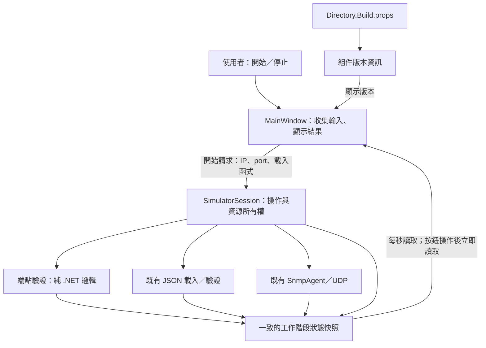
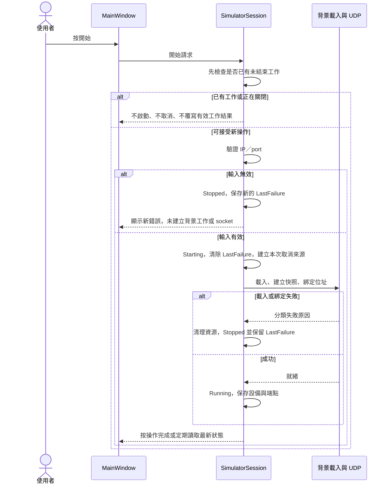
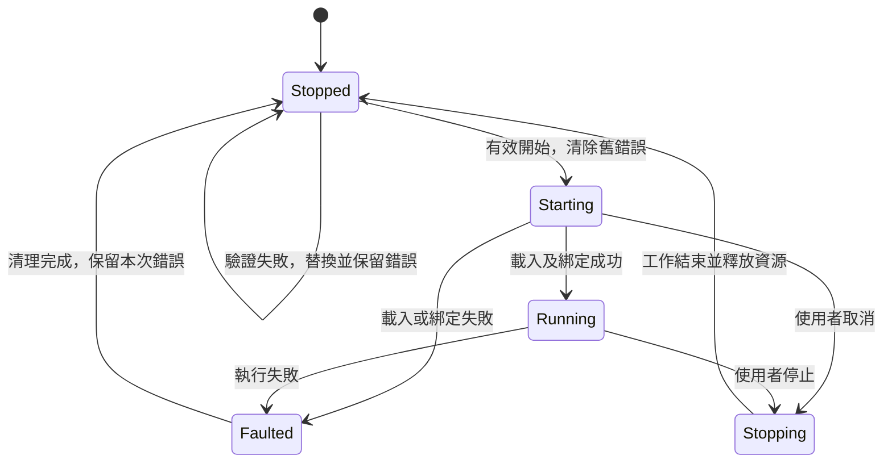
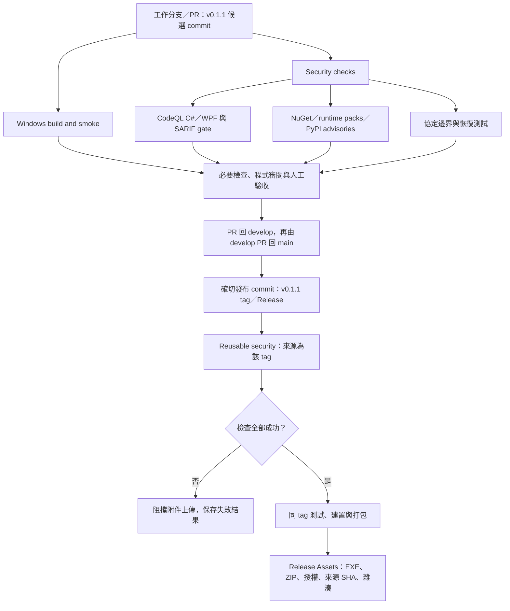

# v0.1.1 增量架構：錯誤狀態、版本來源與安全交付

狀態：已確認的 v0.1.1 架構基準；不是實作完成紀錄。

建立日期：2026-11-06。

依據：[v0.1.1 Spec](v0.1.1-spec.md)、[v0.1.0 架構](../architecture.md)、[安全政策](../../SECURITY.md)。本次檢視基準為 develop 的 `0e03c8e`，已包含安全流程合併。沿用 Spec 內容進行設計，不因建立架構文件而自動授權 FIX／VER 程式變更。

## 1. 設計範圍與原則

v0.1.1 延續 App／Core／Smoke 三專案、單設備、背景 UDP 迴圈、資料快照及現有 JSON schema。這份文件只描述與 v0.1.0 的差異，不重新定義既有 SNMP 行為或整套資料模型。

本版的三項設計重點：

1. 輸入驗證與背景失敗使用同一份持續存在的工作階段結果，消除 UI 與 Core 各存一份有效錯誤的情況。
2. 程式版本由既有集中設定產生，再由組件資訊供 UI 顯示。
3. 開發／發布工作流程執行可追溯的安全檢查，發布前掃描與建置使用同一個 tag。

維持目前 WPF code-behind 與輪詢更新，不引入 MVVM 框架、新服務、資料庫或新的 NuGet 相依；不做視覺改版、OID 表格、封包效能引擎或 v0.2.0 功能。

## 2. 問題根因與責任調整

### 2.1 現有兩條錯誤路徑

- UI 的 IP／port 驗證失敗：Start_Click 的 catch 直接修改 Status.Text，SimulatorSession 不知道這個錯誤。
- JSON／綁定／背景執行失敗：SimulatorSession.Error 保存原因，Refresh 每秒依該值顯示。

結果是 UI 直接寫入的錯誤可能在下一次 Refresh 消失，或重新顯示前一個 session 錯誤。僅停止計時器或在不同 catch 補字串，仍會留下多份來源，不作為本版方案。

### 2.2 建議責任邊界

箭頭表示資料與責任流，不表示新增執行緒或每筆封包通知 UI。SNMP 收送與 OID 查詢不經過視窗，也不需要讀取錯誤訊息模型。

## 3. 一致的工作階段狀態

### 3.1 狀態模型

建議由 SimulatorSession 提供不可變狀態快照，包含：

| 欄位 | 用途 |
| --- | --- |
| State | 延續 Stopped／Starting／Running／Stopping／Faulted |
| LastFailure | 最後有效失敗結果；沒有錯誤時為 null |
| DeviceName／OidCount | 本次成功載入的設備摘要 |
| Endpoint | 本次工作階段實際採用端點，避免失敗重試時顯示其他端點 |

LastFailure 建議包含 Kind、可理解的 Message，以及選用的診斷 Detail。Kind 至少區分 InputValidation、ProfileLoad、Bind、Execution，方便測試及顯示適當修正方向。Detail 不預設顯示完整堆疊、community 或可能敏感的外部資料。

計數仍從既有 Agent 的 Interlocked 累計讀取，不要求每個封包建立新快照。狀態快照與計數不是同一時間點的精確交易，不將畫面累計視為端到端送達證據。

Core 只提供結構化資料，不引用 Window、Dispatcher 或其他 WPF 型別。UI 統一將快照轉成既有狀態文字，不再以 catch 直接寫入一份與 session 不一致的持續錯誤。

### 3.2 狀態存取與相容入口

- 生命週期與快照更新在既有 gate 下協調；對外讀取時取得完整快照，避免讀到新 State 卻搭配舊 Error／端點。
- 暴露可接收原始 IP／port 輸入的開始入口，讓端點驗證在建立 session 資源前完成，並能把失敗保存進 LastFailure。
- 保留或調整目前接受 IPEndPoint 的 StartAsync 測試入口，兩者共用同一生命週期實作；不能複製出兩套清理及錯誤規則。
- 現有 Error 屬性可暫時作 LastFailure.Message 的相容投影，或同步更新呼叫端與測試；不得保留第二份可獨立修改的錯誤字串。
- 新入口與回傳型別名稱在實作時決定；必要不變條件是驗證失敗不開 socket、錯誤可持續讀取、有效啟動才清除舊錯誤。

這是 Core 工作階段的操作結果，不加入一般用途的全域通知中心。

## 4. 開始、失敗與重新嘗試

### 4.1 開始流程

即使稍後需要非同步讀檔，按鈕觸發也應立即呈現 Starting；無效輸入則立即呈現錯誤。更新時只讀目前快照，不把先前 await 返回時捕捉的舊訊息重新貼回畫面。

### 4.2 錯誤保留規則

| 事件 | 執行狀態 | LastFailure |
| --- | --- | --- |
| 無效 IP／port | 維持 Stopped，不建立資源 | 取代為本次驗證錯誤 |
| 沒有新操作，計時器刷新 | 不改變 | 保留原值 |
| 使用者只修改輸入，尚未開始 | 不改變 | 保留；訊息代表上一次操作結果 |
| 新一次有效開始被接受 | Starting | 清除原值 |
| JSON／綁定失敗 | 清理後 Stopped | 保存本次錯誤，不還原舊值 |
| 背景致命錯誤 | Faulted，清理後 Stopped | 保存本次錯誤 |
| 本次正常取消／停止 | Stopping → Stopped | 不新增取消錯誤；停止後依正常結果顯示 |
| 執行中重複開始／無效輸入 | 不改變合法執行中工作 | 不用此請求覆寫正在執行的狀態 |

不加自動逾時清除、不要求使用者趕在下一次刷新前閱讀，也不額外加「清除錯誤」按鈕。停止中的重複停止須可安全處理。

### 4.3 狀態圖

錯誤不只綁在瞬間的 Faulted 狀態，所以 Faulted → Stopped 後仍能看到失敗原因。

## 5. WPF、背景工作與清理

- Refresh 只負責顯示快照、控制項可用性與既有統計，不更動 LastFailure 或工作階段狀態。
- 開始／停止事件呼叫協調入口後立即 Refresh，後續仍維持每秒讀取；不新增高頻通知或每個封包 Dispatcher 操作。
- 原始碼層級可測的端點驗證、錯誤選擇與清除規則留在不依賴 WPF 的部分；UI 只保留格式化與控制項綁接。
- 非預期的 UI 層例外仍需可追蹤；在可安全回報的停止狀態轉為結構化失敗，不用無條件 catch 吞掉所有問題。
- 既有 CancellationTokenSource、Task、socket 的所有權維持由 session 管理；完成清理前不接受新階段，舊工作不得在新階段開始後回寫結果。
- 正常取消依取消 token 判別，不以所有 OperationCanceledException 一律視為正常；既有視窗關閉非同步等待清理，不在 UI thread 用 Wait／Result。
- 操作失敗不得重設其他合法執行中階段、留下監聽或永久停用開始按鈕；關閉中的 UI 不接受新開始。

## 6. 版本來源與發布紀錄

| 層級 | 來源與責任 |
| --- | --- |
| Directory.Build.props | 唯一維護的產品 Version／AssemblyVersion／FileVersion；授權實作時才改為 0.1.1／0.1.1.0 |
| EXE 組件資訊 | 由建置產生，供 UI 讀取本程式組件的產品版本 |
| WPF 視窗 | 組件版本轉成 v0.1.1 顯示；移除 XAML 與程式碼的版本常數，不另存一份版本設定 |
| Release workflow | 驗證 tag v0.1.1 與建置的 Version 一致，再由該確切 tag 發布 |
| README／CHANGELOG | 記錄真實發布／未發布狀態，屬維護文件，不反過來決定程式版本 |

建議 UI 使用本 App 組件的 AssemblyVersion 取 major／minor／build 三段，避免把 informational version 裡的 commit metadata 當成顯示版號；Release source commit 仍透過 SOURCE_COMMIT.txt 追蹤。測試須明確取 App 組件，避免誤讀 Core 或 test host 版本。

v0.1.0 的 tag、雜湊及既有人工驗收不改寫。v0.1.1 候選與正式 Release 分開記錄；新建置使用新 hash。文件不得因版本更新就把未執行的 Windows、授權或安全檢查改成已通過。

## 7. 安全 workflow 與交付架構

安全流程已存在於 develop，本版延用，不重建另一套相同掃描。既有 SAST 成功證據見 [security/verification.md](../../security/verification.md)；它不替未來的 v0.1.1 commit 背書。

目前權限及門檻沿用 SECURITY.md：

- SAST job 才有 security-events:write；一般查詢及測試為 contents:read。發布附件 job 另有 contents:write，且依賴安全 job。
- 不以 pull_request_target 執行 PR 程式；原 main-source-policy 僅檢查 metadata 的用途維持。
- NuGet High／Critical、CodeQL security-severity >=7 或 error 阻擋；PyPI 缺統一嚴重度，所有有效 advisory 阻擋。資料來源失敗與缺報告也阻擋，不轉成乾淨結果。
- 同 tag 的 runtime pack 與 NuGet／Python 相依都須重新盤點。定期掃描、Dependabot 與 Secret scanning 的平台設定是互補機制，不能互相取代。
- CodeQL 為 CI 服務，不進 EXE；產品不新增安全 scanner 套件。授權原生元件對照仍是獨立交付責任。
- required checks、Secret scanning、Push protection 及私人回報由維護者在 GitHub 設定；未取得設定證據前，不宣稱已強制生效。

## 8. 驗證與需求對照

| 設計責任 | Spec 對應 | 驗證位置與證據 |
| --- | --- | --- |
| 持續、替換與清除 LastFailure | FIX-01～02；AC11-01～03 | 非 WPF 邏輯測試：驗證錯誤 → 多次讀取 → 另一錯誤 → 有效開始；不得依賴真正等待三秒才能測核心規則 |
| 載入／綁定失敗後恢復 | FIX-03；AC11-04～05 | 真實 session／UDP 測試；無殘留 socket，同視窗可重試 |
| 取消、關閉與重複操作 | FIX-04；AC11-06 | 狀態轉換與取消測試；Windows 補驗關閉、按鈕及訊息 |
| 版本統一 | VER-01；AC11-09 | 檢查 App 組件／檔案資訊與視窗文字，CI 檢查 tag 與產品版本 |
| 既有 SNMP／JSON 相容 | AC11-07～08 | smoke、PySNMP 互通及代表性內網人工查詢；結果依當次 commit 記錄 |
| 真實版本文件 | DOC-01 | 文件差異與來源資料，已發布／未發布／未驗證分開 |
| 安全與 Release Assets | SEC-01～05；AC11-10 | CodeQL、SCA、protocol job 的真實結果，確切 tag 產物、SOURCE_COMMIT 及 EXE SHA-256 |

Windows 實際顯示至少三秒不被覆蓋仍需補驗；邏輯測試則透過反覆取得快照證明沒有時間自動清除。兩者各自提供證據，不以其中一項取代另一項。

失敗範例先能重現舊行為，再驗證修正；不修改既有 assertion 來掩蓋不相容。執行相關檢查，避免每次文字調整都重跑所有網路測試。

## 9. 現況與後續調整

| 項目 | 目前 | 本版設計 |
| --- | --- | --- |
| IP／port 驗證 | MainWindow catch 直接寫文字 | 由協調入口驗證並保存工作階段失敗結果 |
| 背景錯誤 | session.Error 與 UI 錯誤分開 | 單一 LastFailure，Error 僅作相容投影或移除重複來源 |
| 畫面更新 | Refresh 從多個可變屬性讀取 | 從一致快照格式化，保留原更新頻率 |
| 版號 | 集中 props 加 UI 固定字串 | 集中 props → App 組件 → UI |
| 安全流程 | 已合併 develop；初次 SAST 有成功回報 | 沿用流程，v0.1.1 實際候選／tag 再驗證 |
| 產品修補與版本更新 | 尚未開始 | 待架構確認及實作授權後執行 |

## 10. 已確認的架構重點

1. 接受以 session 統一保存輸入與執行錯誤，UI 只顯示快照，避免新增平行的錯誤來源。
2. 保留三專案與現有輪詢，採最小可測調整，不增加套件或全面重構 UI。
3. 錯誤更新／清除時機依 Spec；重複開始不破壞合法執行中工作，正常取消不產生失敗。
4. 版號依 App 組件讀取，既有 v0.1.0 發布記錄保留。
5. 安全流程沿用現有實作，但候選與 tag 檢查需有新證據，不能沿用舊版通過結果。

架構與任務已確認；獲得產品實作授權後，依 [v0.1.1 任務](v0.1.1-task.md) 的 P11-01～P11-05 執行實作及驗收。本次只同步文件，未修改產品程式、版號、workflow 或測試。

## 11. 本輪實作對照

已新增 SessionFailure／SessionSnapshot；IP／port 與背景失敗由 session 保存，UI 透過無 WPF 相依的 SessionStatusText 格式化，該 App 原始檔直接連結至跨平台測試，維持三專案。CanStart 依 Task 真正完成與 disposed 狀態判斷，補足 Stopped 轉換與 Task 結束間的短暫窗口。

版號由 App 組件取得並集中設定為 0.1.1。Windows workflow 與 Release workflow 增加實際 App／EXE 版本檢查，fix 分支也觸發建置與安全檢查。原生 EXE 版本檢查僅在 Windows 嚴格執行；Linux 不偽裝通過。驗證狀態另見本版 verification 文件。
